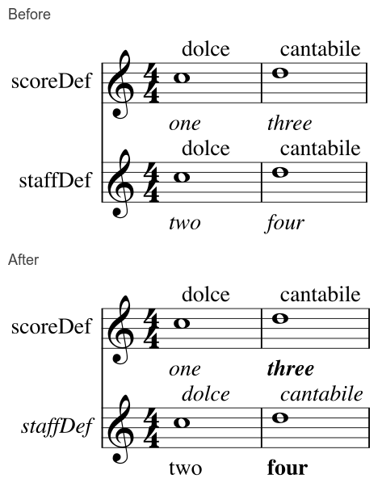

# Reduced Verovio PR examples (2026-11-17)

These small MEI examples accompany independent PRs based on upstream `develop` at `dd5cea020`. They contain no production score assets. Images are generated with Verovio, rasterized with librsvg, and captioned with ImageMagick.

## staffDef text styles

`staffdef-text-styles.mei` sets `lyric.style="italic"` and `text.style="normal"` on the initial `scoreDef`. The first staff inherits them, while the `staffDef` of the second staff overrides them with `lyric.style="normal"` and `text.style="italic"`. A `scoreDef` before the second measure only sets `lyric.weight="bold"`.

Build the relevant branch with the usual CMake CLI build, then run:

```sh
python3 check_text_styles.py --verovio /path/to/build/verovio \
  --resources /path/to/verovio/data --out /tmp/text-styles
```

The checker renders the example to SVG and asserts the `font-style` and `font-weight` of each syllable and direction. It exits with status 1 if any value differs.

| Element | Expected | Baseline `dd5cea020` | Changed branch |
| --- | --- | --- | --- |
| Staff 1 lyrics and directions, measure 1 | scoreDef styles | scoreDef styles | scoreDef styles |
| Staff 2 lyrics, measure 1 | upright | italic | upright |
| Staff 2 directions | italic | upright | italic |
| Lyrics of both staves, measure 2 | bold | regular | bold |

The baseline fails 5 of 8 assertions; the changed branch passes all of them.


